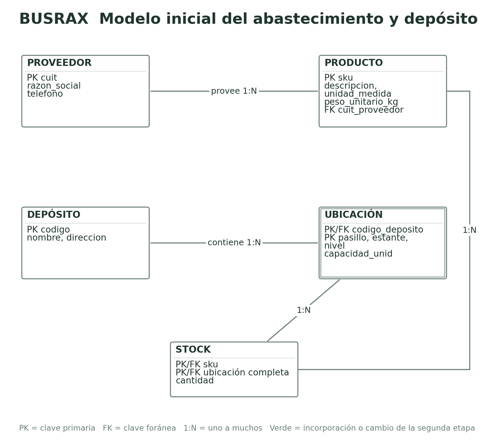
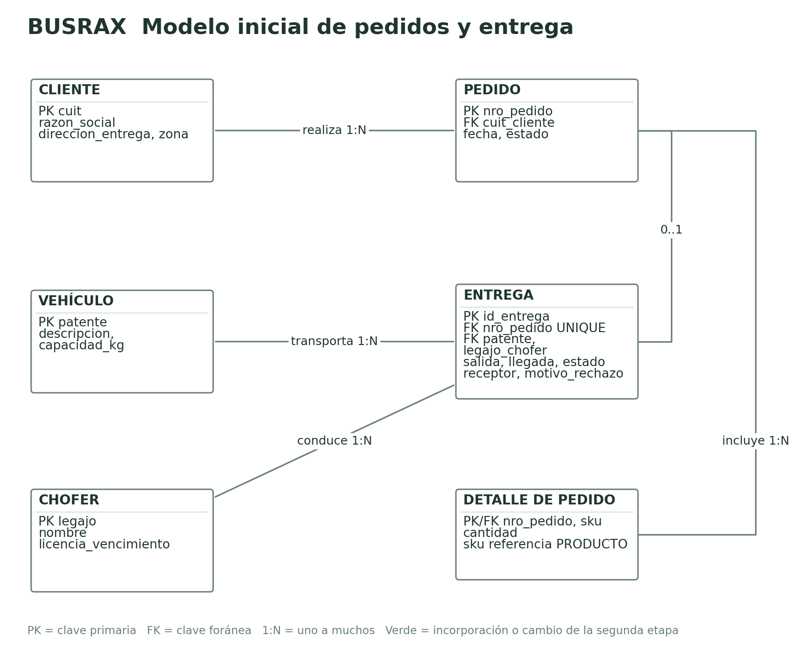
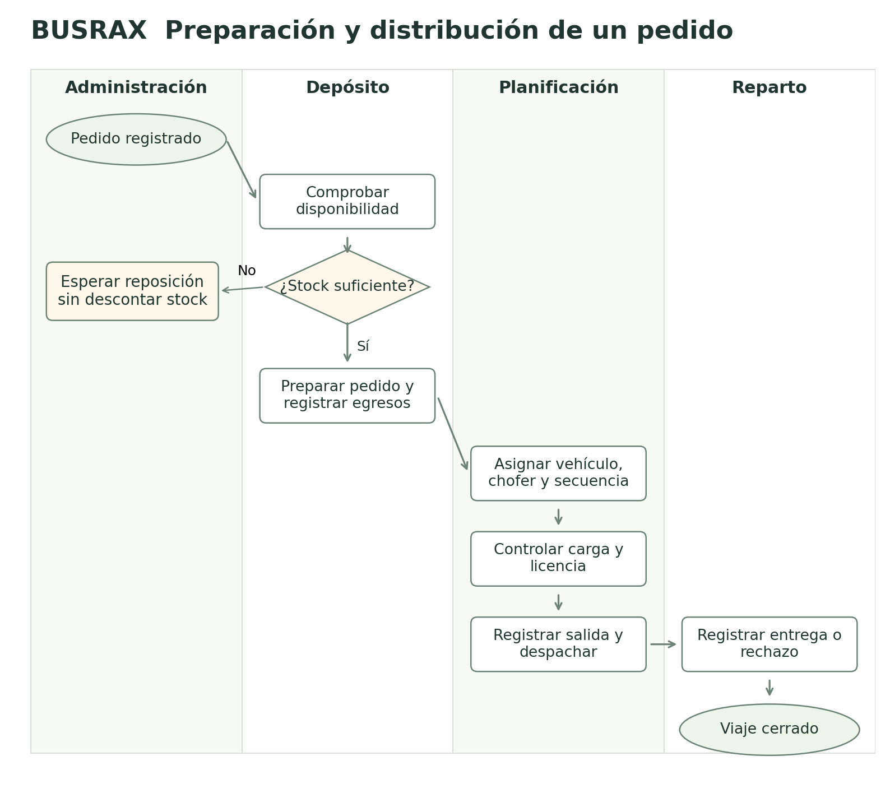

# BUSRAX Primera etapa

Diseño inicial de la base de datos del centro de distribución

Informática Aplicada · Tecnicatura Universitaria en Logística

Sala Santiago

Salinas Maximiliano

Rivero Federico

Profesor Ing. Juan Manuel Goya

23 de octubre de 2026

En este trabajo organizamos la información de un distribuidor regional antes de desarrollar la aplicación. El punto de partida es reconocer qué datos necesita cada operación, cómo se relacionan y qué situaciones la base debe rechazar. BUSRAX es el proyecto de un centro de distribución de productos de almacén, bebidas y limpieza.

El trabajo se organiza en dos etapas del mismo proyecto. La primera desarrolla el análisis, el modelo de datos y el proceso logístico. La segunda incorpora compras, movimientos de stock y hojas de ruta, y presenta la aplicación y sus pruebas.

La operación se ubica en Ituzaingó, Corrientes, y usa productos por bulto, entregas regionales y controles habituales de depósito.

[[PAGE]]
# Enunciado del problema

BUSRAX es un centro de distribución mayorista que abastece a almacenes, autoservicios y kioscos de Ituzaingó y localidades de la zona. Compra a proveedores, identificados por CUIT, razón social y teléfono. Cada producto tiene un SKU, una descripción, una unidad de medida, un peso unitario y un único proveedor. La empresa tiene depósitos con código, nombre y dirección; cada depósito se divide en ubicaciones (pasillo, estante y nivel) con una capacidad máxima de unidades, y una ubicación no existe fuera de su depósito. Un producto puede guardarse en varias ubicaciones y una ubicación puede contener varios productos, con una cantidad en cada caso. Los clientes se registran con CUIT, razón social, dirección de entrega y zona. Cada pedido pertenece a un cliente, tiene número, fecha y estado (pendiente, preparado, despachado, entregado o cancelado) y uno o más renglones con producto y cantidad. Un pedido preparado se entrega una sola vez, con un vehículo (patente y capacidad en kg) y un chofer (legajo, nombre y vencimiento de licencia); la entrega registra salida, llegada, receptor y, si el cliente no la acepta, el motivo del rechazo.

# 1. Análisis del enunciado

## Entidades, atributos e identificadores

| Entidad | Atributos (identificador marcado con PK) | Tipo |
|---|---|---|
| PROVEEDOR | **cuit**, razon_social, telefono | Fuerte |
| PRODUCTO | **sku**, descripcion, unidad_medida, peso_unitario_kg | Fuerte |
| DEPOSITO | **codigo**, nombre, direccion | Fuerte |
| UBICACION | pasillo, estante, nivel (clave parcial), capacidad_unid | Débil (depende de DEPOSITO) |
| CLIENTE | **cuit**, razon_social, direccion_entrega, zona | Fuerte |
| PEDIDO | **nro_pedido**, fecha, estado | Fuerte |
| VEHICULO | **patente**, descripcion, capacidad_kg | Fuerte |
| CHOFER | **legajo**, nombre, licencia_vencimiento | Fuerte |
| ENTREGA | **id_entrega**, fecha_hora_salida, fecha_hora_llegada, estado, receptor, motivo_rechazo | Fuerte |

## Relaciones y cardinalidades

| Relación | Entidades | Cardinalidad | Participación |
|---|---|---|---|
| provee | PROVEEDOR - PRODUCTO | 1:N | Todo producto tiene proveedor; un proveedor puede tener varios productos |
| se divide en (identificadora) | DEPOSITO - UBICACION | 1:N | Toda ubicación pertenece a un depósito |
| se guarda en (atributo cantidad) | PRODUCTO - UBICACION | N:M | Opcional en ambos lados |
| realiza | CLIENTE - PEDIDO | 1:N | Todo pedido tiene cliente; un cliente puede no tener pedidos |
| incluye (atributo cantidad) | PEDIDO - PRODUCTO | N:M | Un pedido tiene al menos un renglón |
| se entrega en | PEDIDO - ENTREGA | 1:1 | Un pedido tiene como máximo una entrega; toda entrega tiene pedido |
| transporta | VEHICULO - ENTREGA | 1:N | Toda entrega usa un vehículo |
| conduce | CHOFER - ENTREGA | 1:N | Toda entrega tiene un chofer |

## Puntos ambiguos y decisiones

| Punto | Decisión y motivo |
|---|---|
| ¿La ubicación tiene código propio? | No. Se identifica por depósito, pasillo, estante y nivel, como se rotula en el depósito. Por eso es entidad débil. |
| "Capacidad" de la ubicación | Se toma en unidades del producto y se controla que la suma del stock de la ubicación no la supere. |
| ¿Un pedido puede salir en dos viajes? | No. Se decide una entrega por pedido; si no entra en un vehículo se divide en dos pedidos. |
| Entrega rechazada | El enunciado pide el motivo; además el pedido no puede marcarse entregado. Se agrega receptor obligatorio cuando la entrega es ENTREGADA. |
| Peso de la carga | No se guarda: se calcula con cantidad por peso unitario. Se usa para no superar la capacidad del vehículo. |
| Licencia del chofer | No se puede despachar con un chofer cuya licencia esté vencida en la fecha de salida. |
| Un vehículo o chofer en dos viajes a la vez | No se permite tener dos entregas EN_CAMINO con el mismo vehículo o el mismo chofer. |
| Producto con varios proveedores | El enunciado dice "un único proveedor". Se respeta; varios proveedores quedarían como mejora. |

[[PAGE]]
# 2. Diagrama MER


[[PAGE]]


[[PAGE]]
# 3. Diagrama logístico



[[PAGE]]
## Correspondencia entre eventos y entidades

| Evento | Actor | Dato que se registra | Entidad del MER |
|---|---|---|---|
| Registro del pedido | Administración | cliente, fecha, estado PENDIENTE; sku y cantidad por renglón | PEDIDO, "incluye" (detalle) |
| Faltante de stock | Administración | se conserva PENDIENTE, sin descuento de stock | PEDIDO |
| Preparación (picking) | Depósito | baja de cantidad por ubicación; estado PREPARADO | "se guarda en" (stock), PEDIDO |
| Despacho | Transporte | patente, legajo, fecha y hora de salida, EN_CAMINO; estado DESPACHADO | ENTREGA, PEDIDO |
| Entrega conforme | Chofer | fecha y hora de llegada, receptor, ENTREGADA; estado ENTREGADO | ENTREGA, PEDIDO |
| Entrega rechazada | Chofer | RECHAZADA y motivo_rechazo | ENTREGA |
| Reingreso al depósito | Depósito | suma de cantidad en la ubicación | "se guarda en" (stock) |
| Ubicación de mercadería del proveedor | Depósito | suma de cantidad, sin superar capacidad_unid | "se guarda en" (stock), UBICACION |

**Correcciones al MER surgidas del diagrama:** el evento de rechazo necesitaba saber por qué el cliente no recibió la mercadería y quién firmó cuando sí la recibió; se agregaron receptor y motivo_rechazo a ENTREGA. La diferencia con el remito del proveedor no tiene dónde registrarse en este modelo (no hay compras ni movimientos); ese control se incorpora en la segunda etapa.

[[PAGE]]
# 4. MR y SQL con IA

Para pasar del modelo conceptual al relacional se utilizó una propuesta asistida por IA. La revisión compara sus tablas y restricciones con las reglas de BUSRAX antes de definir el SQL que utiliza la aplicación.

**Herramienta:** asistente de IA Grok Bot (plan gratuito).

**Pedido (prompt):**

> Sos un diseñador de bases de datos. A partir de este enunciado y de este MER, dame el modelo relacional (tablas, claves primarias y foráneas) y el script SQL completo para PostgreSQL (Supabase). Enunciado: [se pegó el enunciado completo de arriba]. MER: PROVEEDOR(cuit, razon_social, telefono) provee 1:N PRODUCTO(sku, descripcion, unidad_medida, peso_unitario_kg); DEPOSITO(codigo, nombre, direccion) se divide en 1:N UBICACION débil (pasillo, estante, nivel, capacidad_unid); PRODUCTO N:M UBICACION con cantidad; CLIENTE(cuit, razon_social, direccion_entrega, zona) realiza 1:N PEDIDO(nro_pedido, fecha, estado); PEDIDO N:M PRODUCTO con cantidad; PEDIDO 1:1 ENTREGA(id_entrega, fecha_hora_salida, fecha_hora_llegada, estado, receptor, motivo_rechazo); VEHICULO(patente, descripcion, capacidad_kg) y CHOFER(legajo, nombre, licencia_vencimiento) 1:N ENTREGA. Usá solo datos ficticios.

**Respuesta completa:**

Modelo relacional propuesto:

- proveedor(**cuit**, razon_social, telefono)
- producto(**sku**, descripcion, unidad_medida, peso_unitario_kg, *cuit_proveedor*)
- deposito(**codigo**, nombre, direccion)
- ubicacion(**id_ubicacion**, *codigo_deposito*, pasillo, estante, nivel, capacidad_unid)
- stock(**sku, id_ubicacion**, cantidad)
- cliente(**cuit**, razon_social, direccion_entrega, zona)
- pedido(**nro_pedido**, *cuit_cliente*, fecha, estado)
- detalle_pedido(**nro_pedido, sku**, cantidad)
- vehiculo(**patente**, descripcion, capacidad_kg)
- chofer(**legajo**, nombre, licencia_vencimiento)
- entrega(**id_entrega**, *nro_pedido*, *patente*, *legajo_chofer*, fecha_hora_salida, fecha_hora_llegada, estado, receptor, motivo_rechazo)

```sql
CREATE TABLE proveedor (
  cuit VARCHAR(13) PRIMARY KEY,
  razon_social VARCHAR(100) NOT NULL,
  telefono VARCHAR(20)
);
CREATE TABLE producto (
  sku VARCHAR(20) PRIMARY KEY,
  descripcion VARCHAR(150) NOT NULL,
  unidad_medida VARCHAR(10) NOT NULL,
  peso_unitario_kg DECIMAL(8,2) NOT NULL,
  cuit_proveedor VARCHAR(13) NOT NULL REFERENCES proveedor(cuit)
);
CREATE TABLE deposito (
  codigo VARCHAR(10) PRIMARY KEY,
  nombre VARCHAR(80) NOT NULL,
  direccion VARCHAR(150)
);
CREATE TABLE ubicacion (
  id_ubicacion SERIAL PRIMARY KEY,
  codigo_deposito VARCHAR(10) NOT NULL REFERENCES deposito(codigo),
  pasillo VARCHAR(5) NOT NULL,
  estante INT NOT NULL,
  nivel INT NOT NULL,
  capacidad_unid INT NOT NULL CHECK (capacidad_unid > 0),
  UNIQUE (codigo_deposito, pasillo, estante, nivel)
);
CREATE TABLE stock (
  sku VARCHAR(20) REFERENCES producto(sku),
  id_ubicacion INT REFERENCES ubicacion(id_ubicacion),
  cantidad INT NOT NULL CHECK (cantidad >= 0),
  PRIMARY KEY (sku, id_ubicacion)
);
CREATE TABLE cliente (
  cuit VARCHAR(13) PRIMARY KEY,
  razon_social VARCHAR(100) NOT NULL,
  direccion_entrega VARCHAR(150) NOT NULL,
  zona VARCHAR(30)
);
CREATE TABLE pedido (
  nro_pedido SERIAL PRIMARY KEY,
  cuit_cliente VARCHAR(13) NOT NULL REFERENCES cliente(cuit),
  fecha DATE NOT NULL DEFAULT CURRENT_DATE,
  estado VARCHAR(15) NOT NULL DEFAULT 'PENDIENTE'
    CHECK (estado IN ('PENDIENTE','PREPARADO','DESPACHADO','ENTREGADO','CANCELADO'))
);
CREATE TABLE detalle_pedido (
  nro_pedido INT REFERENCES pedido(nro_pedido),
  sku VARCHAR(20) REFERENCES producto(sku),
  cantidad INT NOT NULL CHECK (cantidad > 0),
  PRIMARY KEY (nro_pedido, sku)
);
CREATE TABLE vehiculo (
  patente VARCHAR(10) PRIMARY KEY,
  descripcion VARCHAR(60),
  capacidad_kg DECIMAL(8,2) NOT NULL CHECK (capacidad_kg > 0)
);
CREATE TABLE chofer (
  legajo INT PRIMARY KEY,
  nombre VARCHAR(100) NOT NULL,
  licencia_vencimiento DATE NOT NULL
);
CREATE TABLE entrega (
  id_entrega SERIAL PRIMARY KEY,
  nro_pedido INT NOT NULL REFERENCES pedido(nro_pedido),
  patente VARCHAR(10) NOT NULL REFERENCES vehiculo(patente),
  legajo_chofer INT NOT NULL REFERENCES chofer(legajo),
  fecha_hora_salida TIMESTAMP NOT NULL,
  fecha_hora_llegada TIMESTAMP,
  estado VARCHAR(15) NOT NULL DEFAULT 'EN_CAMINO'
    CHECK (estado IN ('EN_CAMINO','ENTREGADA','RECHAZADA')),
  receptor VARCHAR(100),
  motivo_rechazo VARCHAR(200)
);
```

[[PAGE]]
## Revisión crítica

La propuesta de SQL dejaba sin controlar casos que el negocio no debía permitir: un producto con peso negativo y unidad "XX", 500 unidades en una ubicación de capacidad 10, dos entregas para el mismo pedido, una entrega de un pedido PENDIENTE, una entrega ENTREGADA sin receptor y un chofer con licencia vencida.

| Diferencia con nuestro MER | Corrección aplicada |
|---|---|
| UBICACION con id_ubicacion propio: deja de ser entidad débil | Clave primaria compuesta (codigo_deposito, pasillo, estante, nivel) y FK compuesta en stock |
| PEDIDO - ENTREGA quedó 1:N (nro_pedido sin UNIQUE) | UNIQUE en entrega.nro_pedido |
| No controla capacidad de la ubicación | Trigger que suma el stock de la ubicación y rechaza si supera capacidad_unid |
| No controla estado del pedido, licencia ni peso al despachar | Trigger antes de insertar la entrega |
| Sin control de vehículo o chofer en dos viajes | Índices únicos parciales para entregas EN_CAMINO |
| Sin coherencia estado - datos de la entrega | CHECK: llegada solo si no está EN_CAMINO, receptor si ENTREGADA, motivo si RECHAZADA |
| Peso sin control, unidad libre, CUIT y patente sin formato | CHECK de peso > 0, lista de unidades, CUIT de 11 dígitos y formato de patente |
| SERIAL y TIMESTAMP sin zona | GENERATED ALWAYS AS IDENTITY y TIMESTAMPTZ (salidas y llegadas con hora local) |
| Al borrar un pedido o depósito quedan renglones o ubicaciones huérfanas | ON DELETE CASCADE en detalle_pedido y ubicacion |

El modelo corregido de esta etapa está en docs/etapa1/base_inicial.sql. La aplicación utiliza el modelo de quince tablas que se desarrolla en la segunda etapa del proyecto.


[[PAGE]]
# 5 Verificación en Supabase

El diseño de BUSRAX parte de once tablas para representar productos, ubicaciones, pedidos y entregas. El modelo de la aplicación incluye quince tablas al incorporar compras, movimientos de stock y hojas de ruta. Ambas etapas forman parte del mismo trabajo.

La base de BUSRAX se implementó en Supabase. Las operaciones se probaron con el rol público que usa la aplicación. Las pruebas dejan constancia de qué se aceptó, qué se rechazó y si las operaciones fallidas revirtieron sus cambios.

| Comprobación del sistema | Resultado observado |
|---|---|
| Pedido con dos renglones válidos | Se registra completo |
| Producto inexistente en el detalle | Se rechaza y no queda una cabecera sola |
| Picking desde dos ubicaciones | Se distribuye la cantidad y conserva el saldo correcto |
| Falta de stock en un renglón posterior | Se revierte también el descuento del primero |
| Vehículo de 5 kg para un pedido de 7 kg | Se rechaza la asignación |
| Chofer con licencia vencida | Se rechaza la hoja de ruta |
| Instalación reproducida en un esquema aislado | 15 tablas con RLS y 12 productos |

Las catorce pruebas de integración completas y las capturas actuales están en la segunda etapa. El archivo de prueba ejecuta sus casos con datos separados y los revierte al terminar. Así se puede repetir la comprobación sin dejar productos ni clientes de prueba en la operación.

El modelo de la segunda etapa completa el circuito logístico: registra los movimientos de stock, permite seguir las recepciones de compras y reúne varias entregas en una hoja de ruta. De esa manera, el proyecto relaciona la compra, la preparación y el reparto.
