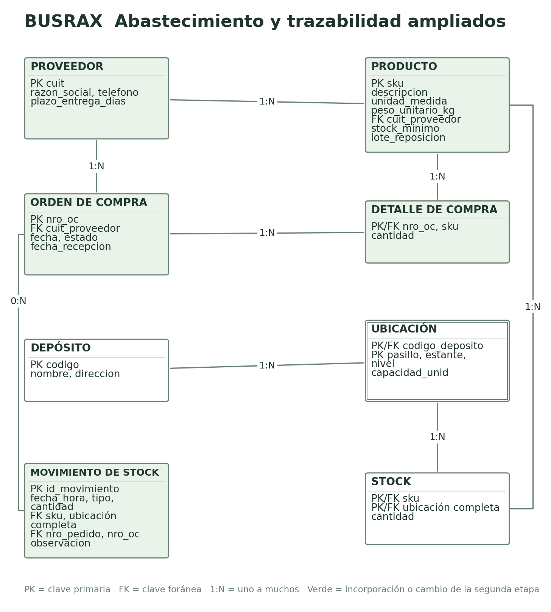
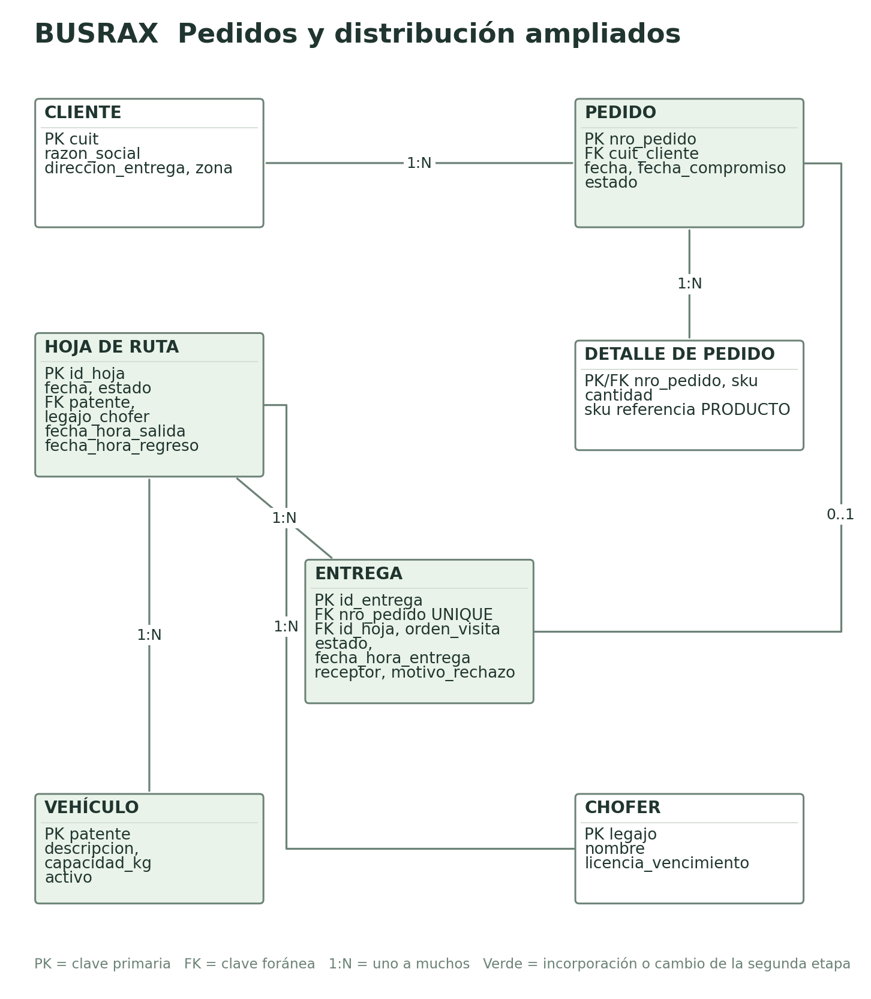
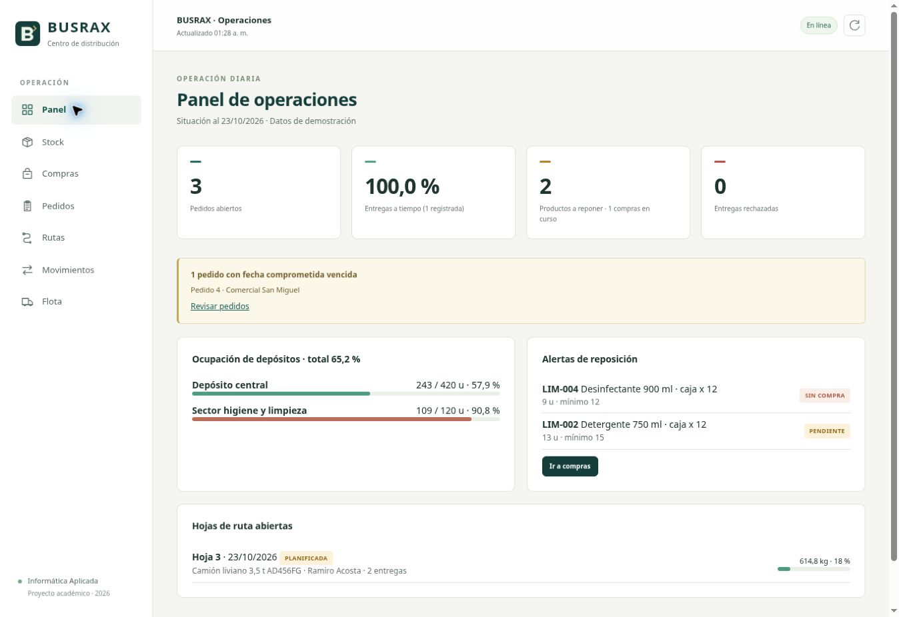
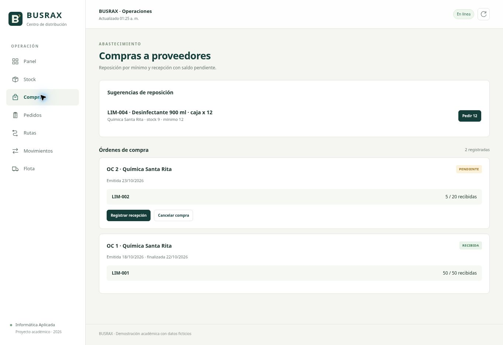
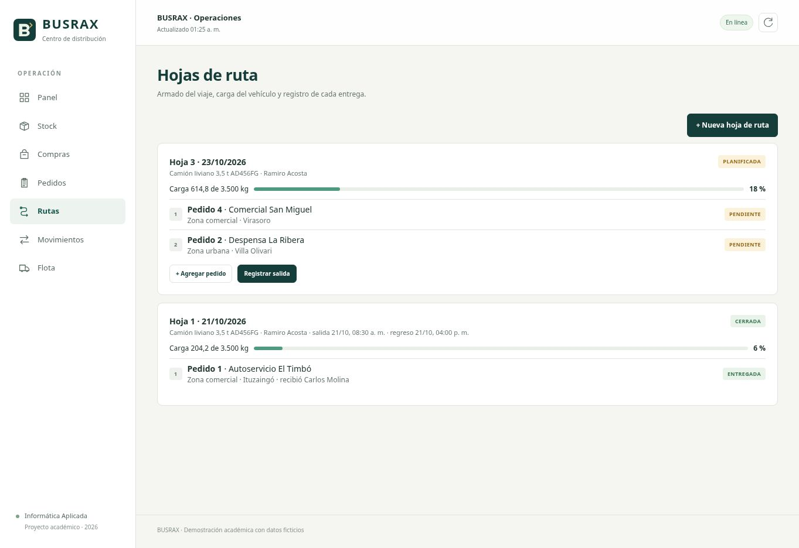
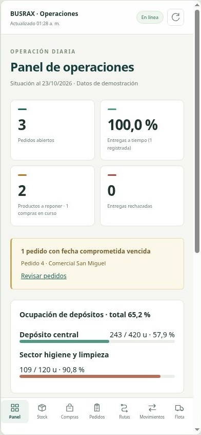

# BUSRAX Segunda etapa

Funciones logísticas y aplicación del centro de distribución

Informática Aplicada · Tecnicatura Universitaria en Logística

Sala Santiago

Salinas Maximiliano

Rivero Federico

Profesor Ing. Juan Manuel Goya

23 de octubre de 2026

BUSRAX es un sistema de operaciones para un centro de distribución regional. El proyecto organiza quince tablas y cinco funciones logísticas: reposición, recepción y trazabilidad, preparación de pedidos, distribución e indicadores. La aplicación permite seguir el circuito desde la compra al proveedor hasta la entrega al cliente.

El diseño contempla situaciones habituales del depósito: una compra puede recibirse en varias entregas, un producto puede estar repartido entre ubicaciones y un pedido solo debe quedar preparado si se pueden confirmar todos sus renglones. La interfaz reúne estas operaciones en pantallas que también pueden utilizarse desde el celular.

El resultado se comprobó con catorce pruebas de integración, cuatro pruebas de los cálculos de la interfaz y una instalación completa en un esquema aislado. La app fue ejecutada y revisada en escritorio y en una vista de 390 píxeles. Las capturas corresponden a la aplicación ejecutada y conectada a Supabase.

[[PAGE]]
# 1 Funciones logísticas

## Reposición

Compras necesita saber qué productos están en el mínimo o por debajo. La función compara el stock total con el mínimo, revisa si ya existe una compra pendiente y propone el lote definido para el producto. La orden y su renglón se crean juntos para no dejar compras vacías.

## Recepción y trazabilidad

Depósito registra cuántos bultos llegaron y dónde se guardaron. Cada ingreso queda relacionado con la orden de compra. La cantidad pendiente se calcula como lo comprado menos los ingresos acumulados, y la orden recién se marca RECIBIDA cuando se completan todos sus renglones.

## Preparación de pedidos

El operario consulta el stock disponible y confirma el picking. Un producto puede estar repartido entre varias ubicaciones, por lo que la preparación debe poder tomar una parte de cada una. Todos los egresos y el estado PREPARADO se guardan en una misma operación. Si no alcanza un producto, no se descuenta ninguno.

## Distribución

Planificación agrupa pedidos preparados, asigna vehículo y chofer y define el orden de visita. La base verifica el peso, la disponibilidad del vehículo y la vigencia de la licencia. La salida cambia la hoja y sus pedidos juntos. Reparto registra el resultado y la hoja se cierra cuando no quedan entregas pendientes.

## Indicadores

El panel resume pedidos abiertos, compras pendientes, productos a reponer, rechazos, entregas a tiempo y ocupación. Agregamos una alerta de pedidos atrasados. Un porcentaje se muestra junto con su cantidad de casos: el 100 % de cumplimiento del ejemplo proviene de una sola entrega realizada, por lo que no representa todavía una tendencia.

[[PAGE]]
# 2 Documento descriptivo del negocio

El texto que sigue describe el alcance de la versión actual y sirve para reproducir sus requisitos. El mismo contenido está en docs/documento_descriptivo.md.

### Contexto

BUSRAX representa un centro de distribución de Ituzaingó, Corrientes, que compra productos de almacén, bebidas y limpieza y abastece comercios de la localidad y de la zona. Opera por cajas, packs y bultos cerrados. El catálogo tiene doce referencias; cada descripción indica el contenido del bulto y el peso unitario corresponde a ese bulto completo. La información combina un depósito central y un sector de higiene y limpieza para evitar mezclar ambos grupos en el almacenamiento.

El problema que se busca resolver es seguir la operación desde la compra hasta la entrega: saber cuánto queda disponible, qué está pendiente de recibir, qué se preparó y qué viaja en cada vehículo. Una confirmación incompleta no debe dejar cantidades descontadas sin que cambie el estado del pedido.

### Actores y responsabilidades

Compras decide la reposición y sigue las órdenes al proveedor. Depósito cuenta lo recibido, elige la ubicación y prepara pedidos. Planificación agrupa pedidos preparados, asigna vehículo y chofer y ordena las visitas. Reparto informa la entrega o el rechazo. La persona responsable de la operación consulta los indicadores. En esta versión estas son responsabilidades del proceso; la aplicación todavía no las separa con usuarios y permisos individuales.

### Datos

El modelo de BUSRAX tiene quince tablas: proveedor, producto, depósito, ubicación, stock, cliente, pedido, detalle de pedido, orden de compra, detalle de compra, movimiento de stock, vehículo, chofer, hoja de ruta y entrega. Las ubicaciones usan la clave compuesta depósito, pasillo, estante y nivel. El stock se identifica por producto y ubicación. Un pedido contiene renglones y tiene como máximo una entrega; cada hoja puede reunir varias entregas.

### Funciones logísticas

La reposición compara el stock total de cada producto con su mínimo. Si está en ese mínimo o por debajo, y no existe una compra pendiente del mismo producto, propone el lote de reposición. La orden y su detalle se crean juntos.

La recepción permite ingresar parte de lo comprado. Los ingresos se acumulan por orden y producto. La compra sigue pendiente hasta completar todos sus renglones y nunca se admite una cantidad mayor que el saldo. El stock aumenta por movimientos, no por una edición directa.

La preparación toma los renglones de un pedido pendiente y propone un recorrido por depósito, pasillo, estante y nivel. Si un producto está repartido entre ubicaciones, puede retirarse de varias. Todos los egresos y el cambio a PREPARADO se confirman juntos. Si falta un producto, la operación completa se revierte.

La distribución reúne pedidos preparados, controla el peso de la carga y verifica que el vehículo esté activo y la licencia vigente. Al iniciar la hoja, los pedidos pasan a DESPACHADO en la misma transacción. Cada resultado de entrega también actualiza su pedido. La hoja no se cierra con entregas sin resolver.

El panel muestra pedidos abiertos, entregas a tiempo, rechazos, compras pendientes, productos por reponer y ocupación. Agrega una alerta de pedidos cuya fecha comprometida ya pasó. El stock y los movimientos se pueden exportar a CSV.

### Reglas del negocio

Las cantidades de pedidos e ingresos son enteros positivos; los ajustes pueden ser negativos, con motivo obligatorio. Ningún movimiento puede dejar stock negativo ni superar la capacidad de la ubicación. En este ejercicio esa capacidad se aproxima en bultos; no reemplaza un cálculo volumétrico del depósito.

Cada producto conserva un proveedor principal. No se admiten compras duplicadas pendientes desde la función de reposición. No se cancela una compra con recepciones registradas ni un pedido ya preparado. El pedido no se prepara dos veces. No se agregan pedidos a una hoja que salió o cerró.

La licencia se vuelve a verificar al salir. No se permiten dos hojas en curso para un mismo vehículo o chofer. Una entrega conforme necesita receptor y un rechazo necesita motivo. El rechazo no es una devolución física automática: el reingreso debe controlarse y registrarse aparte.

El stock es un saldo operativo actualizado por un trigger; se conserva además el historial de movimientos para explicar cómo se llegó a ese saldo. El peso de los pedidos y los porcentajes se calculan mediante consultas.

### Pantallas y reportes

Panel, Stock, Compras, Pedidos, Rutas, Movimientos y Flota. La búsqueda de stock considera SKU, descripción, proveedor y ubicación. La exportación de movimientos incluye los últimos quinientos registros y conserva su referencia de pedido o compra. Los errores de la base se muestran en el formulario sin dar la operación por completada.

### Situación operativa actual

Tres proveedores, doce productos, dos sectores de depósito con siete ubicaciones, cuatro clientes, tres vehículos y tres choferes. Hay cuatro pedidos: uno entregado, dos preparados para un reparto y uno pendiente. Una compra de veinte cajas tiene cinco recibidas y quince pendientes. Uno de los pedidos preparados está atrasado. La hoja abierta lleva 614,8 kg.

### Requisitos técnicos

HTML, CSS y JavaScript, PostgreSQL en Supabase y una función breve de configuración para Vercel. La clave publicable se toma de variables de entorno y no se guarda en los archivos fuente. Se usa supabase-js 2.118.0 incluido con su licencia. Las operaciones compuestas se realizan con funciones SQL llamadas por RPC, con permisos del invocador y las políticas RLS del proyecto. El sitio se revisó en escritorio y en un marco de 390 píxeles para celular.

[[PAGE]]
# 3 Modelo ampliado

El modelo utiliza los identificadores y las relaciones definidos en el análisis de BUSRAX. Las incorporaciones de la segunda etapa se muestran en verde. Dividimos el gráfico en abastecimiento y reparto para que pueda leerse sin reducirlo demasiado.

La ubicación sigue siendo dependiente del depósito y se identifica por depósito, pasillo, estante y nivel. STOCK resuelve la relación entre producto y ubicación. Los renglones de pedido y compra relacionan cada documento con los productos y su cantidad.



[[PAGE]]


## Relaciones que conectan ambos gráficos

Cada movimiento corresponde a un producto y a una ubicación completa. Puede referenciar una compra o un pedido para explicar su origen. El detalle del pedido y el detalle de la compra referencian el mismo catálogo de productos. Esas claves conectan el abastecimiento con la preparación y el reparto.

[[PAGE]]
## Cambios y decisiones del modelo

| Cambio | Motivo |
|---|---|
| ORDEN_COMPRA y DETALLE_ORDEN_COMPRA | Registrar lo pedido al proveedor y calcular lo que falta recibir |
| MOVIMIENTO_STOCK | Explicar cada ingreso, egreso o ajuste y su ubicación |
| HOJA_RUTA | Agrupar varias entregas en un viaje y asignar vehículo y chofer una sola vez |
| fecha_compromiso en PEDIDO | Comparar lo prometido con lo entregado e identificar atrasos |
| stock_minimo y lote_reposicion en PRODUCTO | Definir cuándo sugerir una compra y por cuánto |
| activo en VEHICULO | Evitar la planificación de un vehículo fuera de servicio |
| saldo de una compra calculado desde movimientos | Mantener una única fuente para las cantidades recibidas |

No agregamos una columna de stock total en PRODUCTO. El total se obtiene desde el saldo por ubicación. Ese saldo sí se conserva en STOCK, actualizado por el trigger, y el historial de MOVIMIENTO_STOCK permite revisar su origen. Esta decisión evita calcular toda la historia para cada pantalla sin perder la trazabilidad.

Las operaciones que afectan varias tablas se coordinan con funciones SQL. Por ejemplo, preparar un pedido registra todos sus egresos y cambia su estado en una misma transacción. Los scripts de instalación separan la estructura, los permisos, las funciones y la carga inicial de datos para poder reproducir la base de forma ordenada.

# 4 MR y SQL

## Apoyo de IA y revisión técnica

Se utilizó ChatGPT como apoyo para revisar el modelo relacional, implementar operaciones SQL y preparar pruebas del sistema. El pedido de trabajo se centró en las reglas de BUSRAX: recepciones parciales, stock por ubicación, preparación completa de pedidos y control de las hojas de ruta.

La revisión se centró en operaciones concretas: crear un pedido con sus renglones, recibir una compra de forma parcial, preparar desde varias ubicaciones, despachar una hoja y registrar una entrega. La implementación técnica está en los scripts de instalación y en el código de la aplicación, junto con las pruebas reproducibles.

## Controles de las operaciones

| Riesgo operativo | Control implementado |
|---|---|
| Dar por completa una compra parcialmente recibida | El saldo se calcula desde los ingresos y la compra se cierra al completarlo |
| Descontar solo una parte de un pedido | Una función confirma todos los egresos y el estado en una transacción |
| Tener stock repartido en distintas ubicaciones | La preparación puede tomar una parte desde cada ubicación |
| Registrar una orden o un pedido sin renglones | La cabecera y el detalle se insertan juntos |
| Cambiar una entrega sin actualizar su pedido | El resultado y el estado se confirman en la misma operación |
| Agregar pedidos a un viaje que ya salió | La hoja debe estar en estado PLANIFICADA |
| Ejecutar directamente una función reservada al trigger | Se restringe su ejecución y se fija search_path |

## Preparación de pedidos en el código

La interfaz solicita la preparación mediante una función que confirma los egresos y el estado del pedido:

```javascript
await db.rpc('busrax_preparar_pedido', {
  p_pedido: numeroPedido
});
```

La función bloquea el pedido mientras prepara sus renglones. Para cada producto toma lo disponible en las ubicaciones. Si no alcanza, genera una excepción antes de confirmar. PostgreSQL revierte los egresos de esa operación, incluidos los renglones que ya se habían procesado.

```sql
IF falta > 0 THEN
  RAISE EXCEPTION
    'Faltan % unidades de %. No se descontó ningún renglón',
    falta, d.sku;
END IF;

UPDATE public.pedido
SET estado = 'PREPARADO'
WHERE nro_pedido = p_pedido;
```

En la recepción se compara cada ingreso con el saldo de la orden. El ejemplo de la app tiene veinte cajas pedidas y cinco recibidas. Si se intentan ingresar dieciséis, la base informa que solo quedan quince. La pantalla muestra ese mensaje y no da por terminada la operación.

## Validación durante el desarrollo

La primera ejecución de las pruebas encontró una referencia ambigua al nombre l: se había usado como variable del recorrido y como alias de una consulta. Se reemplazó el alias por item.value y se volvió a ejecutar la comprobación. En la carga del escenario apareció el mismo problema con d; se cambió el alias del detalle a det. Ambos errores quedaron corregidos antes de registrar los resultados finales.

La configuración de las funciones se revisó con la auditoría de seguridad de Supabase. Se fijó search_path y se restringió la ejecución directa de la función del trigger. La comprobación final no devolvió avisos de esa categoría. Los permisos por empleado no forman parte del alcance implementado en esta versión.

[[PAGE]]
## Pruebas ejecutadas

Las siguientes comprobaciones se ejecutaron con el rol anon que usa la app. Los registros creados para las pruebas se revirtieron al finalizar.

| Caso | Resultado |
|---|---|
| Pedido válido con dos renglones | Correcto |
| SKU inexistente no deja un pedido huérfano | Correcto |
| Picking de 6 unidades desde ubicaciones con 3 y 4 | Correcto |
| Segundo picking del mismo pedido rechazado | Correcto |
| Faltante en el segundo renglón revierte el primero | Correcto |
| Recepción de 3 sobre 10 conserva la compra pendiente | Correcto |
| Reposición duplicada rechazada | Correcto |
| Ingreso mayor que el saldo rechazado sin mover stock | Correcto |
| Recepción del saldo completa la compra | Correcto |
| Hoja de ruta con licencia vencida rechazada | Correcto |
| Pedido de 7 kg no cabe en vehículo de 5 kg | Correcto |
| Salida y despacho de pedido confirmados juntos | Correcto |
| Cierre con una entrega pendiente rechazado | Correcto |
| Entrega y cierre de viaje completos | Correcto |

La comprobación de instalación creó un esquema aislado, ejecutó los scripts y verificó doce productos, cuatro pedidos, tres entregas, 352 bultos y quince tablas con RLS activo. Luego revirtió ese esquema. Esto permitió comprobar la entrega sin recrear la base de uso.

Además se ejecutaron cuatro pruebas de la interfaz: distribución del picking entre ubicaciones, detección de faltantes, fecha local de Argentina y exportación CSV con comillas, acentos y protección frente a fórmulas.

# 5 Aplicación

## Pantallas y recorrido

La aplicación cuenta con Panel, Stock, Compras, Pedidos, Rutas, Movimientos y Flota. La revisión de navegador comprobó la carga de datos, la navegación, la búsqueda de arroz en stock y los formularios de recepción. También se intentó una recepción mayor que el saldo para comprobar el mensaje devuelto por la base, sin modificar el stock.

La búsqueda incluye SKU, descripción, proveedor y ubicación. La exportación de stock usa el filtro activo. La de movimientos incluye los últimos quinientos registros. Las cantidades siguen expresadas en bultos completos; el contenido de cada bulto figura en la descripción del producto.

[[PAGE]]
## Panel de operaciones



El panel permite decidir qué atender primero. En el escenario hay tres pedidos abiertos, uno atrasado y dos productos bajo el mínimo. Una compra ya está en curso; el otro producto todavía necesita reposición. El sector de limpieza tiene una ocupación mayor que el depósito central, por lo que una recepción nueva requiere revisar la ubicación disponible.

## Ejemplos con lógica de operación

El catálogo representa una operación regional: arroz y azúcar por bulto, bebidas por pack y productos de limpieza por caja. Los artículos de higiene y limpieza se almacenan en su propio sector. Los movimientos permiten explicar cómo se obtuvo el saldo de cada ubicación. Los datos mantienen cantidades y estados coherentes entre las pantallas.

[[PAGE]]
## Recepción y saldo pendiente



La compra pendiente muestra cinco de veinte cajas recibidas y conserva un saldo de quince. Cada entrega del proveedor se registra sin perder esa referencia. Otra compra ya está completa, con cincuenta cajas pedidas y cincuenta recibidas. La base rechaza cualquier recepción que supere el saldo de la orden.

[[PAGE]]
## Hoja de reparto



La hoja abierta reúne dos pedidos preparados y muestra una carga de 614,8 kg. El orden de visita es una decisión de planificación; la aplicación no calcula automáticamente la ruta más corta. El porcentaje de carga permite comparar el uso del vehículo y decidir si conviene reagrupar pedidos antes de la salida.

## Uso en celular



La vista de celular mantiene los indicadores y el menú inferior. Los formularios tienen controles grandes, cierre con Escape y manejo de foco. La navegación se comprobó a un ancho de 390 píxeles, usando la aplicación real dentro de un marco de ese tamaño.

[[PAGE]]
# 6 Repositorio y publicación

El proyecto BUSRAX incluye aplicación web, modelos, scripts SQL, documentación y pruebas. Los archivos se entregan organizados para que se pueda revisar el diseño y ejecutar el sistema.

El README explica cómo ejecutar la aplicación y configurar las variables de entorno.

Para ejecutar la versión entregada, se copia .env.example como .env, se completan la URL y la clave publicable de Supabase y se usa npm run dev. En Vercel se configuran las mismas variables, con el proyecto de tipo Other y sin compilación. La función api/config.js entrega solo la configuración pública. No se incorpora una clave secreta al navegador ni a los archivos fuente.

## Orden de los archivos

| Carpeta | Contenido |
|---|---|
| Primera etapa | Informe de análisis y modelo inicial en Word y PDF |
| Segunda etapa | Funciones logísticas, aplicación y pruebas en Word y PDF |
| Diagramas | Modelos y proceso en PNG, SVG y draw.io editable |
| Base de datos | Creación para base vacía, carga inicial, RLS y mejoras |
| Código y pruebas | Proyecto limpio con instrucciones y verificaciones |
| Evidencias | Capturas y resultados de las pruebas |
| Consignas | Los documentos originales del docente |

## Límites que conviene explicar en la exposición

La versión actual todavía no separa permisos por empleado. La capacidad del depósito se simplifica en bultos, sin cálculo de volumen. El modelo mantiene un proveedor principal por producto y una entrega por pedido. Un rechazo no aumenta el stock automáticamente: la devolución requiere revisar la mercadería e ingresar un movimiento justificado.

Estas decisiones mantienen el alcance del trabajo y permiten explicar con claridad qué resuelve la aplicación. Las mejoras se concentran en que lo registrado tenga coherencia, que un error no deje operaciones a medias y que cada cantidad pueda relacionarse con su origen.

[[PAGE]]
# Anexo Respuesta inicial de IA

El siguiente esquema es la propuesta preliminar utilizada para revisar las relaciones y las reglas del sistema. Se incluye como parte del proceso de diseño de BUSRAX. Para instalar y probar la aplicación se utilizan los scripts completos de la carpeta Base de datos, que incorporan las restricciones, los permisos y las funciones verificadas.

```sql
-- BUSRAX. Propuesta preliminar del modelo de la segunda etapa.
DROP TABLE IF EXISTS entrega, hoja_ruta, movimiento_stock, detalle_orden_compra, orden_compra,
  detalle_pedido, pedido, cliente, stock, ubicacion, deposito, producto, proveedor, vehiculo, chofer CASCADE;

CREATE TABLE proveedor (
  cuit CHAR(11) PRIMARY KEY,
  razon_social VARCHAR(120) NOT NULL,
  telefono VARCHAR(30),
  plazo_entrega_dias INT NOT NULL DEFAULT 3 CHECK (plazo_entrega_dias >= 0)
);
CREATE TABLE producto (
  sku VARCHAR(20) PRIMARY KEY,
  descripcion VARCHAR(150) NOT NULL,
  unidad_medida VARCHAR(10) NOT NULL CHECK (unidad_medida IN ('UN','CAJA','KG','LT')),
  peso_unitario_kg NUMERIC(8,3) NOT NULL CHECK (peso_unitario_kg > 0),
  cuit_proveedor CHAR(11) NOT NULL REFERENCES proveedor(cuit),
  stock_minimo INT NOT NULL DEFAULT 0 CHECK (stock_minimo >= 0),
  lote_reposicion INT NOT NULL DEFAULT 1 CHECK (lote_reposicion > 0)
);
CREATE TABLE deposito (
  codigo VARCHAR(10) PRIMARY KEY,
  nombre VARCHAR(80) NOT NULL,
  direccion VARCHAR(150) NOT NULL
);
CREATE TABLE ubicacion (
  codigo_deposito VARCHAR(10) REFERENCES deposito(codigo),
  pasillo VARCHAR(5),
  estante SMALLINT,
  nivel SMALLINT,
  capacidad_unid INT NOT NULL CHECK (capacidad_unid > 0),
  PRIMARY KEY (codigo_deposito, pasillo, estante, nivel)
);
CREATE TABLE stock (
  sku VARCHAR(20) REFERENCES producto(sku),
  codigo_deposito VARCHAR(10), pasillo VARCHAR(5), estante SMALLINT, nivel SMALLINT,
  cantidad INT NOT NULL CHECK (cantidad >= 0),
  PRIMARY KEY (sku, codigo_deposito, pasillo, estante, nivel),
  FOREIGN KEY (codigo_deposito, pasillo, estante, nivel) REFERENCES ubicacion
);
CREATE TABLE cliente (
  cuit CHAR(11) PRIMARY KEY,
  razon_social VARCHAR(120) NOT NULL,
  direccion_entrega VARCHAR(150) NOT NULL,
  zona VARCHAR(30) NOT NULL
);
CREATE TABLE pedido (
  nro_pedido INT GENERATED ALWAYS AS IDENTITY PRIMARY KEY,
  cuit_cliente CHAR(11) NOT NULL REFERENCES cliente(cuit),
  fecha DATE NOT NULL DEFAULT CURRENT_DATE,
  fecha_compromiso DATE NOT NULL,
  estado VARCHAR(12) NOT NULL DEFAULT 'PENDIENTE'
    CHECK (estado IN ('PENDIENTE','PREPARADO','DESPACHADO','ENTREGADO','RECHAZADO','CANCELADO'))
);
CREATE TABLE detalle_pedido (
  nro_pedido INT REFERENCES pedido(nro_pedido) ON DELETE CASCADE,
  sku VARCHAR(20) REFERENCES producto(sku),
  cantidad INT NOT NULL CHECK (cantidad > 0),
  PRIMARY KEY (nro_pedido, sku)
);
CREATE TABLE orden_compra (
  nro_oc INT GENERATED ALWAYS AS IDENTITY PRIMARY KEY,
  cuit_proveedor CHAR(11) NOT NULL REFERENCES proveedor(cuit),
  fecha DATE NOT NULL DEFAULT CURRENT_DATE,
  estado VARCHAR(10) NOT NULL DEFAULT 'PENDIENTE' CHECK (estado IN ('PENDIENTE','RECIBIDA','CANCELADA')),
  fecha_recepcion DATE
);
CREATE TABLE detalle_orden_compra (
  nro_oc INT REFERENCES orden_compra(nro_oc) ON DELETE CASCADE,
  sku VARCHAR(20) REFERENCES producto(sku),
  cantidad INT NOT NULL CHECK (cantidad > 0),
  PRIMARY KEY (nro_oc, sku)
);
CREATE TABLE movimiento_stock (
  id_movimiento INT GENERATED ALWAYS AS IDENTITY PRIMARY KEY,
  fecha_hora TIMESTAMPTZ NOT NULL DEFAULT now(),
  tipo VARCHAR(8) NOT NULL CHECK (tipo IN ('INGRESO','EGRESO','AJUSTE')),
  sku VARCHAR(20) NOT NULL REFERENCES producto(sku),
  codigo_deposito VARCHAR(10) NOT NULL, pasillo VARCHAR(5) NOT NULL, estante SMALLINT NOT NULL, nivel SMALLINT NOT NULL,
  cantidad INT NOT NULL,
  nro_pedido INT REFERENCES pedido(nro_pedido),
  nro_oc INT REFERENCES orden_compra(nro_oc),
  observacion VARCHAR(200),
  FOREIGN KEY (codigo_deposito, pasillo, estante, nivel) REFERENCES ubicacion
);
CREATE TABLE vehiculo (
  patente VARCHAR(9) PRIMARY KEY,
  descripcion VARCHAR(60) NOT NULL,
  capacidad_kg NUMERIC(8,1) NOT NULL CHECK (capacidad_kg > 0),
  activo BOOLEAN NOT NULL DEFAULT true
);
CREATE TABLE chofer (
  legajo INT PRIMARY KEY,
  nombre VARCHAR(120) NOT NULL,
  licencia_vencimiento DATE NOT NULL
);
CREATE TABLE hoja_ruta (
  id_hoja INT GENERATED ALWAYS AS IDENTITY PRIMARY KEY,
  fecha DATE NOT NULL DEFAULT CURRENT_DATE,
  patente VARCHAR(9) NOT NULL REFERENCES vehiculo(patente),
  legajo_chofer INT NOT NULL REFERENCES chofer(legajo),
  estado VARCHAR(11) NOT NULL DEFAULT 'PLANIFICADA' CHECK (estado IN ('PLANIFICADA','EN_CURSO','CERRADA')),
  fecha_hora_salida TIMESTAMPTZ,
  fecha_hora_regreso TIMESTAMPTZ
);
CREATE TABLE entrega (
  id_entrega INT GENERATED ALWAYS AS IDENTITY PRIMARY KEY,
  nro_pedido INT NOT NULL UNIQUE REFERENCES pedido(nro_pedido),
  id_hoja INT NOT NULL REFERENCES hoja_ruta(id_hoja),
  orden_visita SMALLINT NOT NULL,
  estado VARCHAR(10) NOT NULL DEFAULT 'PENDIENTE' CHECK (estado IN ('PENDIENTE','ENTREGADA','RECHAZADA')),
  fecha_hora_entrega TIMESTAMPTZ,
  receptor VARCHAR(120),
  motivo_rechazo VARCHAR(200)
);

-- El stock se actualiza con cada movimiento
CREATE OR REPLACE FUNCTION fn_aplicar_movimiento() RETURNS trigger AS $$
BEGIN
  INSERT INTO stock (sku, codigo_deposito, pasillo, estante, nivel, cantidad)
  VALUES (NEW.sku, NEW.codigo_deposito, NEW.pasillo, NEW.estante, NEW.nivel,
          CASE WHEN NEW.tipo = 'EGRESO' THEN -NEW.cantidad ELSE NEW.cantidad END)
  ON CONFLICT (sku, codigo_deposito, pasillo, estante, nivel)
  DO UPDATE SET cantidad = stock.cantidad + EXCLUDED.cantidad;
  RETURN NEW;
END; $$ LANGUAGE plpgsql;
CREATE TRIGGER trg_aplicar_movimiento AFTER INSERT ON movimiento_stock
FOR EACH ROW EXECUTE FUNCTION fn_aplicar_movimiento();

-- Productos a reponer
CREATE VIEW v_reposicion AS
SELECT p.sku, p.descripcion, p.stock_minimo, p.lote_reposicion, COALESCE(SUM(s.cantidad),0) AS stock_actual
FROM producto p LEFT JOIN stock s ON s.sku = p.sku
GROUP BY p.sku
HAVING COALESCE(SUM(s.cantidad),0) < p.stock_minimo;

-- Indicadores
CREATE VIEW v_indicadores AS
SELECT
  (SELECT COUNT(*) FROM pedido WHERE estado = 'PENDIENTE') AS pedidos_pendientes,
  (SELECT COUNT(*) FROM entrega WHERE estado = 'ENTREGADA') AS entregas_realizadas,
  (SELECT COUNT(*) FROM entrega WHERE estado = 'RECHAZADA') AS entregas_rechazadas,
  (SELECT COUNT(*) FROM v_reposicion) AS productos_a_reponer;
```
